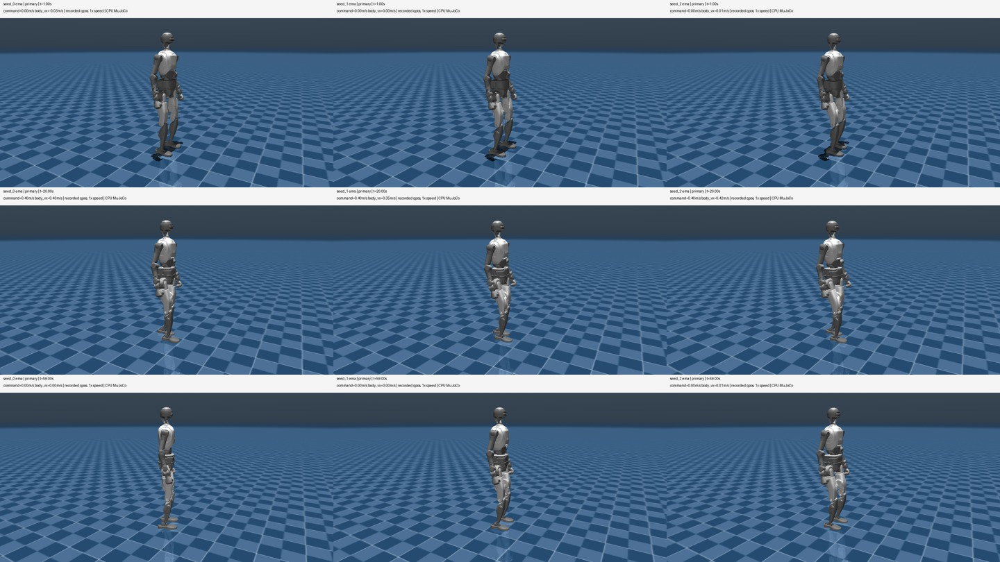

# Dex-BlinkWalk：五分钟从零站走复现包

本包交付已验证的同一套训练配方及三个成功种子。包含独立代码、机器人资产、三个选定模型、评测结论和完整视频。不含失败实验产物、历史检查点和训练缓存。

**从随机 actor 和随机世界模型开始，约五分钟训练得到基础静站与行走能力。预热不计入五分钟；300.31 秒按用户确认接受。** 这不是旧模型续训，也没有使用 LAFAN、专家动作、AMP 判别器、参考动作跳连或固定站立控制器。机器人几何、PD 参数和解析步态奖励属于公开的任务先验。

经验总结见 [第一阶段经验教训与后续原则](LESSONS_LEARNED.md)，包括六条核心经验、冷启动与评测口径、交付检查及待验证的 AMP 方案。

## 1. 先看结果

打开 [视频总览](videos/index.html)，或直接播放下表的 MP4。全部为同一个 0.4m/s 指令流程，原速、完整 60 秒，初态种子固定为 1000。镜头跟随机器人，不能用画面居中判断世界坐标下没有横向漂移。

| 训练种子 | 模型保存完成训练时间 | 留出静站60秒 | 留出有效行走28秒 | 留出完整站走停60秒 | 平均实际前进速度 | 完整视频 |
|---|---:|---:|---:|---:|---:|---|
| 0 | 295.64 秒 | 10/10 | 10/10 | 10/10 | 0.396 m/s | [seed 0](videos/seed_0.mp4) |
| 1 | 300.31 秒 | 10/10 | 10/10 | 8/10 | 0.389 m/s | [seed 1](videos/seed_1.mp4) |
| 2 | 295.55 秒 | 10/10 | 10/10 | 10/10 | 0.396 m/s | [seed 2](videos/seed_2.mp4) |



表中统一使用 **EMA** 模型。`models/seed_N/policy.pt` 仅提取对应检查点的 EMA 策略和评测所需配置，不含 live 策略、世界模型或优化器。导出前后 EMA 参数逐项一致，来源和哈希见同目录 `checkpoint.json`。从零训练不读取这些交付模型。

“10/10”是每个训练种子上的十个留出初态，不是十个训练种子。留出扰动为初始关节位置高斯噪声，标准差 0.01 rad。另有每组 CPU/GPU 三初态筛查；指标与来源见 [结果汇总](results/summary.json)。

**已知边界：** seed 1 的两个留出初态在停车后摔倒；seed 0 有明显累计横向路径偏移；seed 2 静站漂移约 14–15 cm。当前结果不能证明精确到点、自然 AMP 风格、转向、复杂地形、抗推扰、真机表现，或全面等同原 Isaac RL 长时间训练的效果。低速小步走不在本包验收范围内。

## 2. 环境准备

训练运行于 **Linux x86_64 + NVIDIA CUDA GPU**。本次验证设备为 RTX5880-Ada-16Q、16 GiB 显存、32 CPU、64 GB RAM，Python 3.11.15，驱动 570.172.18。Mac 上可以保存代码、查看文档和视频；本包的 GPU 训练路径未适配 Apple GPU。

### 在 luckylhf 上复用现有环境

将整个目录复制到一个新的远端目录，进入该目录后运行：

```bash
export DEX_PYTHON=/home/longhongfeng/Desktop/Dex-BlinkMimic/.venv/bin/python
"$DEX_PYTHON" reproduce.py verify
```

该路径仅用于选择已经安装的 Python 环境。训练不读取旧工程源码、资产、动作数据或旧权重；包内代码和资产均独立。

### 新机器准备环境

在本包根目录执行，先安装与实验一致的 CUDA 12.8 PyTorch，再安装锁定依赖：

```bash
python3.11 -m venv .venv
source .venv/bin/activate
python -m pip install --upgrade pip
python -m pip install torch==2.9.0 --index-url https://download.pytorch.org/whl/cu128
python -m pip install -r requirements.txt
export DEX_PYTHON="$PWD/.venv/bin/python"
"$DEX_PYTHON" -c 'import torch; print(torch.__version__, torch.cuda.is_available()); assert torch.cuda.is_available()'
"$DEX_PYTHON" reproduce.py verify
```

版本依据见 [实验环境记录](configs/environment.json)。PyTorch 安装源见其[官方历史版本说明](https://pytorch.org/get-started/previous-versions/)。本包在已有验证环境中完成检查；未在一台全新机器上重复整套安装。首次编译需要额外时间和磁盘空间，建议至少预留 20 GB。不要在同一块 GPU 上并行启动三个训练。

## 3. 从零训练三个种子

```bash
"$DEX_PYTHON" reproduce.py train --seed 0
"$DEX_PYTHON" reproduce.py train --seed 1 --cache-from reproduce_seed0
"$DEX_PYTHON" reproduce.py train --seed 2 --cache-from reproduce_seed0
```

命令依次等待每轮训练结束。第一轮使用空编译缓存；后两轮仅复制编译缓存，所有模型与学习统计仍重新初始化。可去掉 `--cache-from`，让每轮均重新编译。训练入口没有预训练权重参数，并禁止 `torch.load` / `torch.jit.load`。

三个命令固定 [success_recipe.json](configs/success_recipe.json) 中的成功配方，只改变随机种子。重复运行时必须更换输出名，例如：

```bash
"$DEX_PYTHON" reproduce.py train --seed 0 --name second_seed0
```

本次主配置：4096 环境、400Hz 物理、50Hz 策略、23 个控制轴、84×10 历史观测、动作缩放 0.25；世界模型 512 宽、8 帧窗口、batch 1024；策略 batch 512、48 步想象；每真实步 3 次世界模型更新和 2 次策略更新；前 200 次迭代只更新世界模型；策略 Adam、世界模型 Muon、EMA 0.995。想象神经网络使用 BF16，状态积分、几何、奖励与观测保持 FP32。

### 计时与冷启动

预热包括导入、初始化、编译和图捕获，全部单独记录。预热完成后恢复初始随机参数、EMA、归一化统计，清空优化器状态、经验缓冲和更新计数，再开始 300 秒训练计时。世界模型前期拟合、真实采样、策略更新及保存均在训练计时内。独立评测与视频生成另计。

时间是墙钟预算，硬件、编译器和负载会影响完成的更新量，不能保证换机器后相同秒数得到逐位一致的模型。本次三个选定模型约使用 512–525 万条真实转移、3654–3750 次世界模型更新、2036–2100 次策略更新尝试；完整记录见各模型目录的 `checkpoint.json`。

### 输出及中途停止

训练生成 `runs/reproduce_seedN/`，不会覆盖已有目录。以下文件用于复核：

| 文件 | 用途 |
|---|---|
| `INITIALIZATION.json` | 随机参数哈希、种子、零更新计数和未读取检查点的记录 |
| `PREWARM_RESET.json` | 预热后参数与统计恢复一致、优化器与 replay 清零断言 |
| `checkpoints.jsonl` | 每次保存的精确完成时间、采样量、优化更新量 |
| `train_0295.pt`、`last.pt` | 接近五分钟的模型；必须结合实际时间和行为判断 |
| `FINISHED.json`、`train.jsonl` | 完成状态及训练指标 |

源码快照和哈希自动保存在 `backups/`、`audit/`；这些是用户重新训练时生成的记录，不是包内携带的历史中间物。训练可以在新终端中用 `touch runs/reproduce_seed0/STOP` 请求保存后结束。启动命令的终端应保持连接，或放在用户自己的 tmux 会话中。

## 4. 复查包内三个模型

```bash
"$DEX_PYTHON" reproduce.py eval --seed 0
"$DEX_PYTHON" reproduce.py eval --seed 1
"$DEX_PYTHON" reproduce.py eval --seed 2
```

每个命令均在独立 CPU MuJoCo 中运行静站和站走停场景，使用初态 1000、1001、1002，输出到 `outputs/seed_N/`。CPU 评测不属于五分钟训练时间。首次评测会自动解压唯一一份共享物理模型到 `.cache/`；文件哈希会校验。

十个留出初态的复查：

```bash
"$DEX_PYTHON" reproduce.py eval --seed 0 --heldout
"$DEX_PYTHON" reproduce.py eval --seed 1 --heldout
"$DEX_PYTHON" reproduce.py eval --seed 2 --heldout
```

输出目录已存在时程序拒绝覆盖；使用 `--out outputs/recheck_seed0` 指定新目录。

## 5. 评测自己重新训练的模型

```bash
"$DEX_PYTHON" reproduce.py eval --checkpoint runs/reproduce_seed0/train_0295.pt --out outputs/new_seed0
"$DEX_PYTHON" reproduce.py eval --checkpoint runs/reproduce_seed1/last.pt --out outputs/new_seed1
"$DEX_PYTHON" reproduce.py eval --checkpoint runs/reproduce_seed2/train_0295.pt --out outputs/new_seed2
```

这是本次成功模型对应的检查点位置，不是保证新训练必须选择这些文件。重新训练后应结合 `checkpoints.jsonl` 的精确时间和独立评测选模型；`last.pt` 可能略超预算。额外加 `--heldout` 可运行十个留出初态。

验收协议：

- **静站：** 连续 60 秒，无摔倒，平面速度平均误差小于 0.1m/s，起终点漂移小于 0.25m。
- **流程：** 0–10秒静站，10–12秒平滑升至0.4m/s，12–40秒行走，40–42秒平滑降速，42–60秒停车。
- **有效行走：** 存活到40秒，有完整28秒行走数据，平面速度平均误差小于0.15m/s，两足各至少4次整脚抬起。
- **抬脚：** 足底所有碰撞体最低点超过1cm计一次；回落至5mm以下后才能再次计数，排除只翘脚尖的假象。
- **完整站走停：** 全程60秒并满足初始静站、行走和停车门槛；停车速度误差小于0.1m/s、漂移小于0.25m。
- 根部高度低于0.65m、姿态直立程度低于0.6或非有限状态判失败。当前门槛没有约束世界坐标航向与路径位置。

## 6. 生成自己的视频

评测包内模型后运行：

```bash
"$DEX_PYTHON" reproduce.py video --seed 0
```

视频写入 `outputs/video_seed_0/replay.mp4`。重训模型的示例：

```bash
"$DEX_PYTHON" reproduce.py video \
  --evaluation outputs/new_seed0/v0.4/train_0295_ema_primary_seeds1000-1001-1002.json \
  --out outputs/new_seed0_video
```

视频按记录的 qpos 以1倍速回放，不重新推理策略、不修改轨迹。`--index 1` 或 `2` 选择其他筛查初态。Linux 默认使用 EGL 离屏渲染；需可用的 NVIDIA 图形驱动。若 EGL 不可用但有桌面显示，可设置 `MUJOCO_GL=glfw` 后重试。

## 7. 包内结构与实现来源

```text
README.md                 使用步骤、结论和限制
LESSONS_LEARNED.md         经验教训、证据要求与 AMP 后续原则
reproduce.py              固定成功配方的统一入口
requirements.txt          运行依赖
src/dexnewrl/             已验证的 Dex 任务、世界模型和训练代码
runtime/blinkmimic/       主线实际使用的运行时依赖
configs/                  成功配方、验收协议、环境记录、核心源码哈希
models/seed_0..2/         每个种子唯一选定检查点及冷启动证明
models/physics_scene.mjb.gz  三个模型共用的原始物理场景
results/                  选定模型的最终评测数据，无历史试验记录
videos/                   三段完整视频、预览图和离线总览
tools/                    启动、备份、独立评测与渲染工具
xSIM_MUJOCO-main/          原始 MJCF 和所需40个网格
TienKung-Lab/              原始 PD / 默认姿态配置，仅读取不导入 Isaac
Deploy_Tienkung/           控制轴配置
MANIFEST.json             全包文件 SHA-256
```

核心训练代码与三个成功运行的冻结源码一致；交付层仅增加简化命令、共享物理模型路径和视频入口。部分上游通用模块保留原有接口，主入口固定成功配方，不提供失败实验配方。方法借鉴 [SuperMimic](https://github.com/HybridRobotics/supermimic)、[BlinkMimic](https://github.com/fuyichen0725/blinkmimic) 与 [XSoma 固定版本](https://github.com/nico-bohlinger/xsoma/tree/835410a2646c224addd536b3fb857ca84260ff7a)。许可与归属见 `runtime/LICENSE` 和 `vendor/THIRD_PARTY_NOTICES.md`；机器人资产随用户项目交付，不在此新增再授权声明。

本包的检查范围和实测结果见 [交付验证](results/package_validation.json)。不包含 Isaac/ROS 真机部署或 ONNX 导出入口。

## 8. 真机部署建议：复用 Dex-RL 部署栈

本包只到 MuJoCo CPU 评测，没有 ROS 2 节点、通信层、状态机、安全保护和 ONNX 导出入口。建议复用 **Dex-RL** 的 ROS 2 部署栈（`rl_control` 包、七状态 FSM、`run_real.sh` / `run_sim.sh`、`bodyctrl_msgs` 与本体 SDK 接口），本包负责提供策略和观测契约。

Dex-RL 地址：<https://github.com/luckylhf/Dex-RL>。其真机验证环境为 x86_64 本体板、Ubuntu 24.04、ROS 2 Jazzy，29 路执行器，策略控制其中 23 个关节。

**这不是已经完成的真机适配，本文只是把已核对一致的部分和仍需验证的部分写清楚。** 本包未在真机上运行过。

### 8.1 已核对一致的接口契约

下表逐项比对本包的 `src/dexnewrl/task.py`、`src/dexnewrl/robot.py` 与 Dex-RL 的 `Deploy_Tienkung/policy/walk_amp/`（`walk_amp.yaml`、`fsm_walkamp.py`）：

| 契约项 | 本包 | Dex-RL `walk_amp` | 结论 |
|---|---|---|---|
| 观测维度 | 84 维 × 10 帧历史，共 840 | `observations_size: 84`、`num_hist: 10` | 一致 |
| 观测顺序 | 角速度 3 + 重力投影 3 + 命令 3 + 关节位置误差 23 + 关节速度 23 + 上一步动作 23 + 相位 6 | 同序拼接 | 一致 |
| 相位 6 维 | `sin(左), sin(右), cos(左), cos(右), 0.38, 0.38`；周期 0.85 秒，左右偏移 0.38 / 0.88 | `gait_phase()`，参数默认值相同 | 一致 |
| 策略输入输出 | 840 → 23 | `[1,840] → [1,23]`，加载时校验 | 一致 |
| 动作映射 | `q0 + 0.25 × a` | `action_scale: 0.25` + `default_joint_angles` | 一致 |
| 默认姿态 | `TienKung-Lab` 的 `InitialStateCfg.joint_pos` | `init_state.default_joint_angles` | 23 项逐项相同 |
| PD 增益 | `TienKung-Lab` 的 `ImplicitActuatorCfg` 刚度/阻尼 | `gains.kp/kd` | 23 项逐项相同 |
| 观测裁剪 | ±100 | `clip_observations: 100.0` | 一致 |
| 关节顺序 | 本包仅读取 `walk_amp.yaml` 的 `joint_names` | 同一份文件 | 同一来源 |

`task.py` 首行注释 "Actor contract is original84x10, allscales1" 指的就是这套部署契约，因此复用部署栈不需要改观测定义、动作缩放、默认姿态或增益。

### 8.2 需要新增或修改的部分

1. **导出 ONNX**：`models/seed_N/policy.pt` 的 `actor` 已包含 `RunningNorm` 归一化，可用 `torch.onnx.export` 直接导出为 `[1,840] → [1,23]` 单输入单输出模型，替换 Dex-RL 侧的 `policy/walk_amp/model/policy.onnx`，或放成独立状态目录。
2. **推理频率**：Dex-RL 全局 `dt: 0.01`（100 Hz），本包训练控制周期为 0.02 秒（50 Hz）。把状态配置里的 `control.decimation` 改为 `2` 即可，`timer_gait_` 仍按 0.01 累加，相位在真实时间上的推进与训练一致，不需要改写相位逻辑。
3. **命令限幅**：训练只采样前向速度，`y` 与 `yaw` 恒为 0，命令每步变化上限 0.005 / 0.005 / 0.01。真机手柄应禁用侧向和转向输入，并对前向命令按同样速率限幅，否则策略会收到训练分布外的指令。
4. **末端关节保持**：23 个受控关节以外，沿用 Dex-RL 已有的锁存保持逻辑。
5. **安全层**：STOP 状态、阻尼停止、反馈超时与故障处理全部由 Dex-RL 提供，本包内没有实现，不可省略。

### 8.3 上真机前的验证顺序

1. **数值对拍**：同一切点的 ONNX 与 `policy.pt` 在同一初态下跑 60 秒，动作和 qpos 误差应在 1e-5 量级。
2. **闭环仿真**：在 Dex-RL 的 `run_sim.sh`（ROS 2 + MuJoCo）中运行新状态，与 `results/seed_0/` 和 `videos/seed_0.mp4` 的轨迹对比。
3. **真机低速**：`ZERO → 新状态`，限速起步，有人看护，先确认站立 10 秒再给前向命令。

必须自行核对的一点：重力投影与角速度的来源不同。本包直接用 MuJoCo 姿态矩阵（`-R[...,2,:]`），部署侧由 IMU 欧拉角转四元数后再做逆旋转。语义应当等价，但符号与转置必须用同一组姿态数值对拍确认。此外，更换模型时仍需按 Dex-RL 的流程核对增益，脚踝的串联关节空间转换依赖 `sptlib_python`。

**已知边界：** 本包只验收平地、前向 0.4 m/s、60 秒流程，没有训练转向、侧向、后退、复杂地形和抗推扰；seed 1 有两个留出初态在停车后摔倒，seed 0 存在明显累计横向路径偏移。真机必须保留保护逻辑并低速起步，当前策略不能作为精确到点或自然步态的交付依据。
